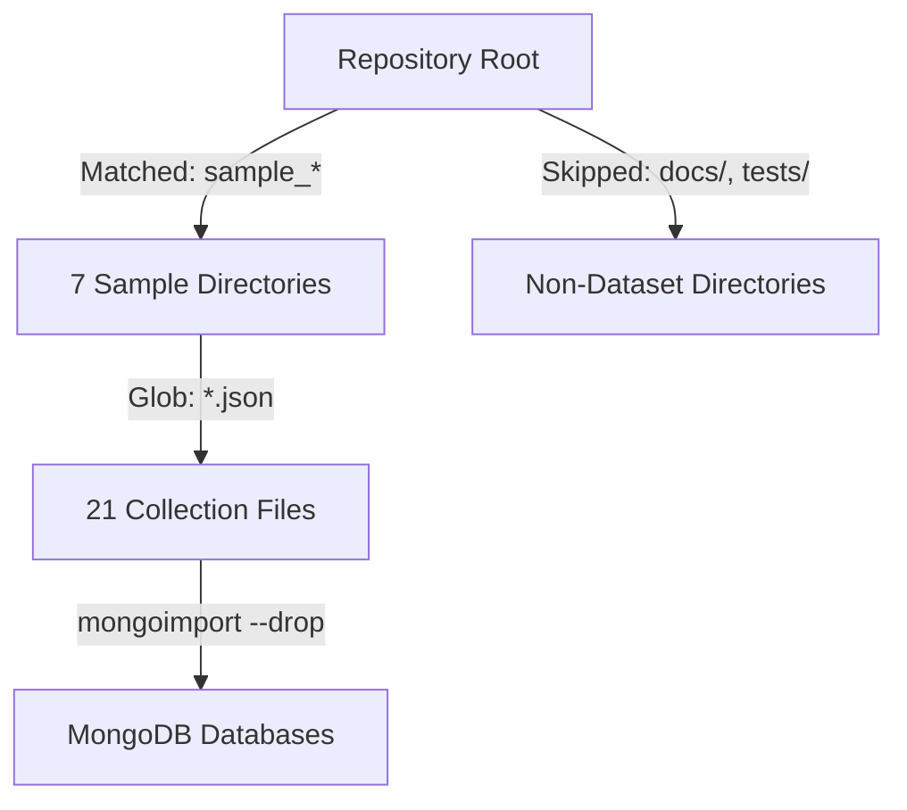

# NDJSON Storage and Loader Design

## Why NDJSON Replaces BSON Dumps

Original Atlas exports used binary BSON archives (`mongorestore`). Storing one Extended JSON document per line (`*.json` NDJSON) makes records inspectable with plain CLI tools (`head`, `grep`, Python `json.loads`) and portable across MongoDB major releases without `mongodump` format mismatches.

## Directory Scoping in `script.sh`

Earlier revisions iterated with `for directory in *`, assuming every top-level directory held JSON collections. Adding documentation (`docs/`), tests (`tests/`), or auxiliary folders broke that assumption.

Restricting discovery to `sample_*/*.json` isolates loader execution cleanly from documentation, test code, and hidden metadata folders.

## Trade-Off: `mongoimport --drop` Semantics

`script.sh` passes `--drop` so repeated tutorial runs replace collections cleanly without duplicate `_id` key errors. The trade-off is destructive replacement on any existing `sample_*` database of the same name; production servers must never be targeted directly.

## Related Documentation

- Exact collection counts and sizes: [Datasets and Loader Reference](../03-reference/datasets-and-script-spec.md)
- Operational import runbook: [Import and Verify Sample Datasets](../02-how-to-guides/import-and-verify-datasets.md)
